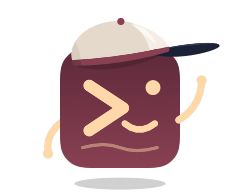

<picture>
  <source media="(prefers-color-scheme: dark)" srcset="https://raw.githubusercontent.com/mooring-sh/.github/main/assets/assistant-dark.png">
  
</picture>

# Mooring

### Ship more from every Claude session.

Mooring is a free Mac app, the agentic development environment (ADE) for Claude Code.

### [Download for macOS &nbsp;→](https://mooring.sh/download)

macOS 26 · Apple silicon

 

**Your work doesn't stop when you do.**
Quit Mooring and your Claude sessions keep running. Open it again and they're
right where you left them. If your Mac sleeps or restarts, your tabs come back
with each conversation ready to resume.

**Think out loud.**
A voice queue catches the idea while your hands are busy, and it runs on your
Mac, so nothing you say leaves it.

**Never lose the thread.**
Every project, branch and task in one window, with a full history of what
changed and why.

 

### [Download Mooring &nbsp;→](https://mooring.sh/download)

Updates itself, so you download it once.

 

[mooring.sh](https://mooring.sh) &nbsp;·&nbsp; [hello@mooring.sh](mailto:hello@mooring.sh)

A <a href="https://stratagems.com">Stratagems</a> product.

