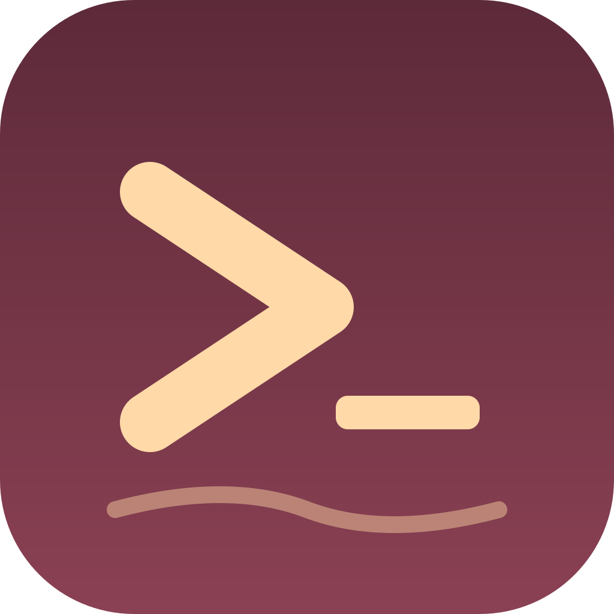

# Mooring

### Ship more from every Claude session.

The Mac app that turns Claude Code into a workspace.

### [Download for macOS &nbsp;→](https://dl.mooring.sh/Mooring.dmg)

macOS 26 · Apple silicon

 

**Your work doesn't stop when you do.**
Quit the app. Close the lid. Come back tomorrow. Your sessions are still
running, exactly where you left them.

**Think out loud.**
A voice queue catches the idea while your hands are busy — and it runs on your
Mac, so nothing you say leaves it.

**Never lose the thread.**
Every project, branch and task in one window, with a full history of what
changed and why.

 

### [Download Mooring &nbsp;→](https://dl.mooring.sh/Mooring.dmg)

Updates itself, so you download it once.

 

[mooring.sh](https://mooring.sh) &nbsp;·&nbsp; [hello@mooring.sh](mailto:hello@mooring.sh)

A <a href="https://stratagems.com">Stratagems</a> product.

